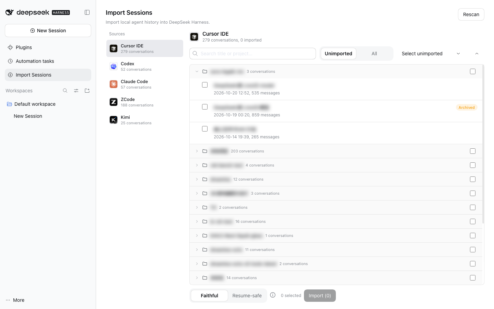

# dsh-agent-session-import

[English](README.en.md) | [简体中文](README.md)

[](https://www.npmjs.com/package/dsh-agent-session-import)
[](https://www.npmjs.com/package/dsh-agent-session-import)
[](LICENSE)
[](https://dsh-plugin.org/plugins/howtomakeaname/dsh-agent-session-import)

Import **local conversation history from third-party coding agents** into **DeepSeek Harness (DSH)** sessions.
An installable DSH bundle plugin: the host reads each agent's local data read-only, while the browser side provides the import panel. Zero runtime dependencies; no build step required.

Supported sources:

| Source | Local data read (read-only) |
| --- | --- |
| **Codex** (CLI and desktop share the same store) | `~/.codex/sessions/**.jsonl` + `~/.codex/thread_history_1.sqlite` |
| **Claude Code** | `~/.claude/projects/**.jsonl` |
| **Cursor IDE** (Agent / Composer) | `~/Library/Application Support/Cursor/User/globalStorage/state.vscdb` |
| **ZCode** | `~/.zcode/cli/db/db.sqlite` |
| **Kimi** (Kimi Code CLI / desktop) | `~/.kimi-code/sessions` (Windows: `%USERPROFILE%\.kimi-code\sessions`; override with `KIMI_CODE_HOME`; macOS also covers the desktop runtime path) |

Other agents (Aider, Continue, …) only need a new provider file. See [docs/adding-provider.md](docs/adding-provider.md).

## Installation

### Install from npm

1. Open **Plugins** in the DSH sidebar.
2. Choose **Add plugin** and enter the package name (optionally with a version):

   ```
   dsh-agent-session-import
   dsh-agent-session-import@0.2.4
   ```

3. Click **Install**, then **Enable now** when installation finishes (or enable it from the Plugins list).
4. The **Import Sessions** item appears in the sidebar when the plugin is ready. On desktop, the hot composition usually takes a few seconds; restart DSH if the panel does not appear.

### Install from GitHub

1. Open **Plugins → Add plugin**.
2. Enter the repository URL (pinning a commit is recommended):

   ```
   git+https://github.com/howtomakeaname/dsh-agent-session-import.git
   ```

   Alternatively, clone the repository locally and use the absolute path to that directory (for example, `~/code/dsh-agent-session-import`).
3. Click **Install → Enable**. Restart DSH after changing the source code.

To uninstall: **Plugins → the plugin → Uninstall**. Uninstalling does not delete sessions that were already imported.

## Usage

1. Click **Import Sessions** in the sidebar.
2. Choose a source on the left, expand a project group, select conversations (or use **Select unimported**), choose a mode, and click **Import**.
3. Check the per-item results in the progress dialog. Completed sessions appear in the sidebar session list under their workspace group.

## Features

- **Import Sessions** sidebar panel with a source navigation column on the left and a conversation list grouped by project folder on the right. Each row shows its title, update time, message count, and Imported/Archived badges.
- Search, `Unimported / All` scope switching, group-level select-all, **Select unimported**, and per-row selection. The import dialog shows total progress, the current item, per-item results, and retry for failed items.
- Two import modes (both preserve content; they differ in how the history is represented and sent):
  - **Faithful**: thinking blocks, tool calls, and tool results remain structured cards, which is best for reading. Continuing the session may be constrained by model API validation of historical `tool_use` / `thinking` wire events.
  - **Resume-safe**: the same content is kept as text (`【思考】` / `[工具调用]` / `[工具结果]`), with tool/thinking wire structures removed, so any model can safely continue the conversation.
- One source conversation becomes one DSH session, restoring the original project directory when possible (falling back to the user's home directory when it no longer exists).
- Session titles and message counts are written into the DSH projection cache, so imported sessions are visible in the sidebar immediately.
- Imported records are stored in `$DSH_HOME/session-import/imported.json`; re-importing shows a badge, and the list refreshes after an import finishes.

## UI preview



> Session titles and project names in the screenshot are blurred; the image only illustrates the panel layout.

## Project structure

- `lib/host/` — host-side plugin:
  `service.js` (endpoint orchestration and import jobs), `scan.js` (source scan cache),
  `jobs.js` (progress/cancel/retention window), `state.js` (persisted imported mapping),
  `writer.js` (DSH v4 session writer), `cursor-store.js` + `convert.js` (Cursor reader),
  `providers/` (source providers and registry).
- `src/client/` — the actual ES module source: `runtime`, `icons` (brand and sidebar icons),
  `styles` (CSS), `i18n` (dictionaries), `utils`, `components`, `panel`, `apply`, `index`.
  esbuild (a devDependency) bundles it into a single file, with platform modules kept external.
- `lib/client.js` — the generated single-file bundle built from `src/client/*.js`; it is the
  only client file DSH loads, and its header marks it as generated.

```bash
npm install            # install esbuild and other dev dependencies (runtime stays dependency-free)
npm run build:client   # regenerate lib/client.js after changing src/client/
npm test               # unit tests (two writer modes, provider order/contract)
npm run check          # bundle freshness, syntax, README screenshot, absolute paths, etc.
```

## Session header and source context

- The first surface event of every imported session is an **empty `system/message`** (a protected surface head) required by DSH v4. When the conversation continues, DSH re-renders the system prompt from the current cwd, tool set, preset, and model; the plugin never hard-codes a system prompt into the session log.
- The first user message begins with a source-context text block that tells the model which agent the history came from and that historical tool names may differ from the current DSH tools. It is ordinary user-role text and is preserved on every continuation path.

## Known limitations

- **Codex**: the full reasoning chain is not persisted in plain text; only the visible summary is available locally. The desktop and CLI share `~/.codex`, and both are covered.
- **Kimi**: only Kimi Agent / Kimi Code sessions are supported; ordinary Kimi chats live on the server, so their content is not available locally.
- **ZCode**: the schema is tied to ZCode 0.16.x; rewind sessions are imported as linear history.
- **Cursor**: the reader follows the on-disk composer format rather than a hard-coded app version. V1 (`_v < 3`) reads tool payloads from `composerData.capabilities[].data.bubbleDataMap`; V3+ (`_v >= 3`) reads `toolFormerData` on each bubble. Cursor 3.30 `/t:` / `/s:` sub-records are read as messages. The separate Cursor 3.30 Agents Window / CLI transcript store under `~/.cursor/projects/**/agent-transcripts/*.jsonl` is not imported yet.
- Tool results larger than 20,000 characters and thinking blocks larger than 12,000 characters are truncated and annotated.
- Very large histories are read in pages; individual corrupt lines are skipped and counted.
- In Faithful mode, the model service may validate foreign `tool_use` / thinking events in the history when continuing. Use Resume-safe for reliable continuation.

## Data and privacy

- Third-party local data is read-only (SQLite is opened through a read-only URI); original data is neither modified nor copied.
- The plugin makes no network requests of its own; all processing happens inside the local DSH host process.
- Deleting `$DSH_HOME/session-import/imported.json` only resets the "already imported" records; it does not delete the sessions themselves.

## Adding a new source

Implement `status/list/load` in `lib/host/providers/<id>.js` and add one line to `OPTIONAL_PROVIDERS` in `lib/host/providers/registry.js`. The full contract, field mapping, and invariants are documented in [docs/adding-provider.md](docs/adding-provider.md).

## Publishing (maintainers)

```bash
npm run check                     # bundle structure, no absolute paths, client entry checks
npm pack --dry-run                # confirm the tarball only contains lib, docs, README, LICENSE, CHANGELOG
npm login                         # skip if already logged in
npm publish --access public       # publish to npm (use an explicit --registry if the default is unavailable)
```

The plugin can also be installed directly from Git (DSH's Add plugin supports Git specs). To appear in the Discover market, host a `dsh-plugin-market-index`-format index JSON and icon at a publicly reachable URL and let users add it as an index source.

## Platform support

| Platform | Status |
| --- | --- |
| macOS | End-to-end import of all five sources has been verified on a real machine (listing, import, cold read, UI) |
| Windows / Linux | Paths and SQLite access are handled cross-platform: Cursor uses `%APPDATA%` / `~/.config`; Codex, Claude Code, and ZCode use the user directory; cwd is checked with `path.isAbsolute`; the SQLite CLI is resolved from PATH. CI runs unit tests and package checks on `ubuntu-latest`, `macos-latest`, and `windows-latest`, but **importing real local data has not been verified on a physical Windows machine** |

- Kimi Code CLI sessions are read from `KIMI_CODE_HOME` / `~/.kimi-code/sessions` and are supported on macOS, Windows, and Linux. The built-in runtime path for Kimi desktop is currently resolved for macOS; on other platforms only that part may be unavailable.
- SQLite access prefers `node:sqlite` (provided by the DSH runtime on each platform, with no preinstalled sqlite3 required). It falls back to `sqlite3` / `sqlite3.exe` on PATH only when the module is missing at runtime; `SQLITE3` can override the executable.

## Compatibility

- Developed and verified on DSH 0.2.x (desktop 0.2.1-rc.2).
- The Cursor reader has been exercised against the composer store of Cursor 3.30.14 stable; both V1 and V3 tool-data layouts are covered by unit tests.
- The package has zero runtime dependencies. The host side uses Node built-ins, and the browser side reuses static DSH platform modules such as `@deepseek-ai/dsh-client-ui-primitives`.

## License

MIT
