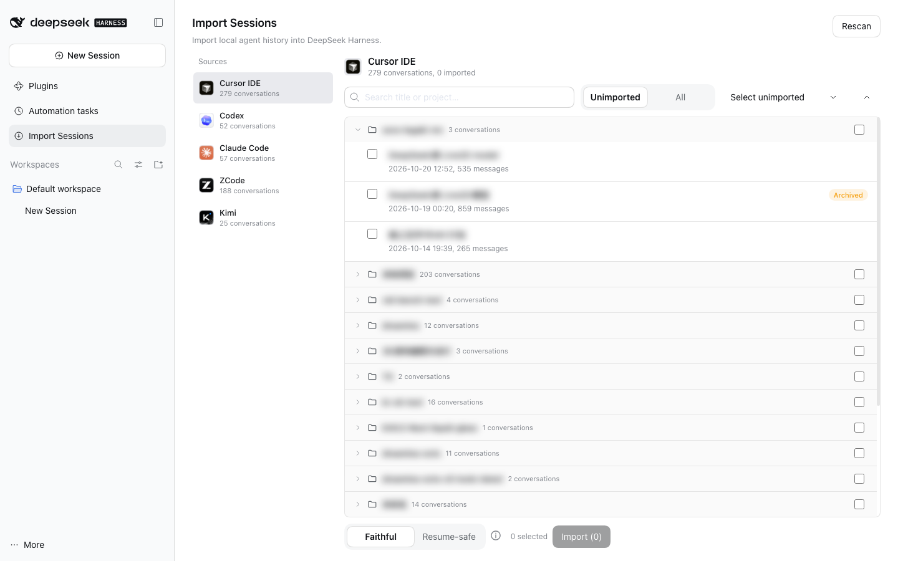

# dsh-agent-session-import

把 **第三方 coding agent 的本地对话记录**导入为 **DeepSeek Harness（DSH）会话**。
一个可安装的 DSH bundle 插件：host 侧只读各 agent 的本地数据，浏览器侧提供导入面板；零运行时依赖、无需构建。

支持来源：

| 来源 | 读取的本地数据（只读） |
| --- | --- |
| **Codex**（CLI / 桌面版共用同一存储） | `~/.codex/sessions/**.jsonl` + `~/.codex/thread_history_1.sqlite` |
| **Claude Code** | `~/.claude/projects/**.jsonl` |
| **Cursor IDE**（Agent / Composer） | `~/Library/Application Support/Cursor/User/globalStorage/state.vscdb` |
| **ZCode** | `~/.zcode/cli/db/db.sqlite` |
| **Kimi**（Agent / Kimi Code） | `~/Library/Application Support/kimi-desktop/.../kimi-code/home/sessions` |

其他 agent（Aider、Continue……）只需新增一个 provider 文件，见 [docs/adding-provider.md](docs/adding-provider.md)。

## 界面预览



> 截图中的会话标题与项目名已做模糊处理，只用于展示界面布局。

## 功能

- 侧边栏 **Import Sessions** 面板：左侧来源导航，右侧会话列表**按项目文件夹分组、可展开/收起**，显示标题、更新时间、消息数和 Imported/Archived 徽标。
- 支持搜索、`Unimported / All` 范围切换、组级全选、Select unimported、逐条勾选；导入弹窗展示总进度、当前条目、逐条结果，失败项可重试。
- 两种导入模式（**内容都不丢**，区别只在展示与请求结构）：
  - **Faithful**：思考、工具调用与结果保留为结构化卡片，最适合阅读；续聊时可能受模型 API 对历史 `tool_use`/`thinking` 的校验限制。
  - **Resume-safe**：同样的内容以文本保留（`【思考】` / `[工具调用]` / `[工具结果]`），去掉 tool/thinking wire 结构，任何模型都能安全继续对话。
- 一条来源对话 → 一条 DSH 会话，尽量回到原项目目录（目录不存在时回退到用户 home）。
- 会话标题与消息数写入 DSH 投影缓存，导入后侧边栏直接可见。
- 已导入记录保存在 `$DSH_HOME/session-import/imported.json`，重复导入会显示徽标；导入结束后列表自动刷新。

## 安装

### 从 npm 安装（发布后可用）

1. 打开 DSH 侧边栏 **Plugins**。
2. **Add plugin** → 输入包名（或带版本）：

   ```
   dsh-agent-session-import
   dsh-agent-session-import@0.2.2
   ```

3. Install → 完成后点 **Enable now**（或到 Plugins 列表启用）。
4. 侧边栏出现 **Import Sessions** 即可使用。桌面端通常数秒内热组合生效；未出现则重启 DSH。

### 从 GitHub 安装

1. Plugins → Add plugin。
2. 输入仓库地址（推荐固定 commit）：

   ```
   git+https://github.com/howtomakeaname/dsh-agent-session-import.git
   ```

   或本地 clone 后用该目录的绝对路径（例如 `~/code/dsh-agent-session-import`）。
3. Install → Enable。修改代码后重启 DSH 生效。

卸载：Plugins → 该插件 → Uninstall。卸载不会删除已导入的会话。

## 使用

1. 侧边栏点 **Import Sessions**。
2. 左侧选来源 → 展开项目分组 → 勾选要导入的对话（或 Select unimported）→ 选模式 → **Import**。
3. 进度弹窗里查看每条结果；完成的会话会出现在左侧会话列表中（归入对应工作区分组）。

## 会话头部与来源说明

- 每条导入会话的第一个 surface 事件是一个**空的 `system/message`**（受保护 surface head），满足 DSH v4 的格式要求；
  续聊时由 DSH 按当前 cwd、工具集、preset 与模型重新渲染 system prompt，插件不会把 system prompt 硬编码进日志。
- 第一条 user 消息开头会注入一段来源说明 text block，告诉模型历史来自哪个 agent、历史工具名与当前 DSH 工具不同，
  仅作参考。它是普通 user-role 文本，在所有续聊路径中都会保留。

## 已知限制

- **Codex**：完整 reasoning 链不落明文，本地只保留可见的 summary；桌面版与 CLI 共用 `~/.codex`，已一并覆盖。
- **Kimi**：只支持 Kimi Agent / Kimi Code 会话；普通 Kimi 聊天记录在服务端，本地没有正文。
- **ZCode**：schema 绑定 ZCode 0.16.x；rewind 会话按线性历史导入。
- 工具结果超过 2 万字符、思考超过 1.2 万字符会截断并标注。
- 超大历史按页读取；个别损坏行会跳过并计入统计。
- Faithful 模式续聊时，模型服务可能校验历史中的 foreign `tool_use` / thinking；需要稳定续聊请用 Resume-safe。

## 数据与隐私

- 只读第三方本地数据（SQLite 以只读 URI 打开），不修改、不复制原始数据。
- 插件本身不发送网络请求；所有处理都在本机 DSH Host 进程内完成。
- 删除 `$DSH_HOME/session-import/imported.json` 只会重置「已导入」记录，不会删除会话本身。

## 扩展新来源

在 `lib/host/providers/<id>.js` 实现 `status/list/load`，并在 `lib/host/providers/registry.js` 的 `OPTIONAL_PROVIDERS`
加一行即可。完整契约、字段映射与不变量见 [docs/adding-provider.md](docs/adding-provider.md)。

## 发布（维护者）

```bash
npm run check                     # bundle 结构 / 无绝对路径 / client 入口检查
npm pack --dry-run                # 确认 tarball 只包含 lib、docs、README、LICENSE、CHANGELOG
npm login                         # 已登录可跳过
npm publish --access public       # 发布到 npm（默认 registry 不可用时显式 --registry）
```

也可以直接从 Git 仓库安装（DSH 的 Add plugin 支持 git spec）；若要在 Discover 市场出现，需要把
`dsh-plugin-market-index` 格式的索引 JSON 与图标托管到可公开访问的 URL，让用户添加 index source。

## 兼容性

- 在 DSH 0.2.x 上开发与验证（桌面版 0.2.1-rc.2）。
- 包本身零运行时依赖；host 侧使用 Node 内置模块，浏览器侧复用 DSH 平台内置的
  `@deepseek-ai/dsh-client-ui-primitives` 等静态模块。

## License

MIT
